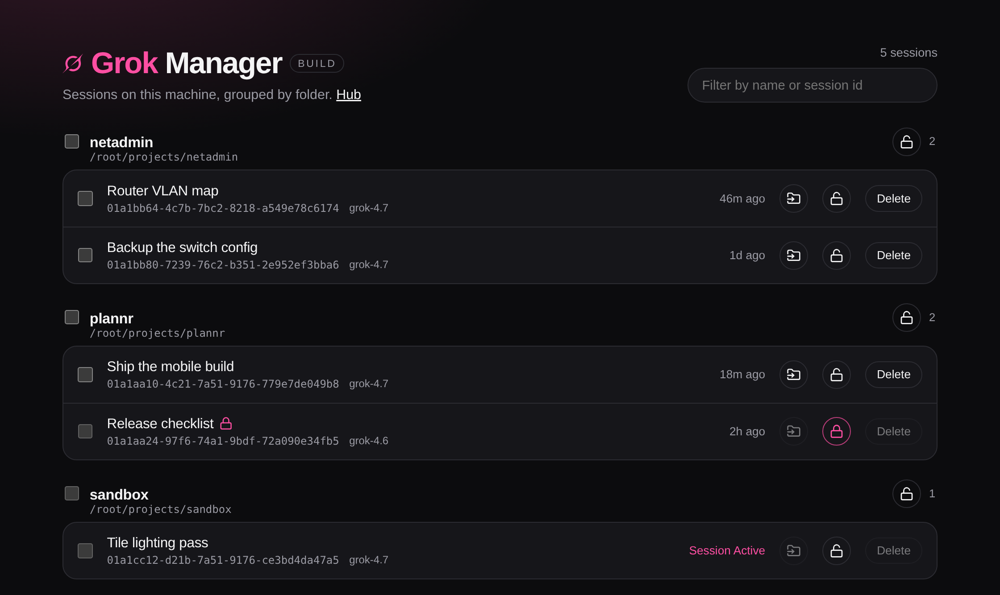
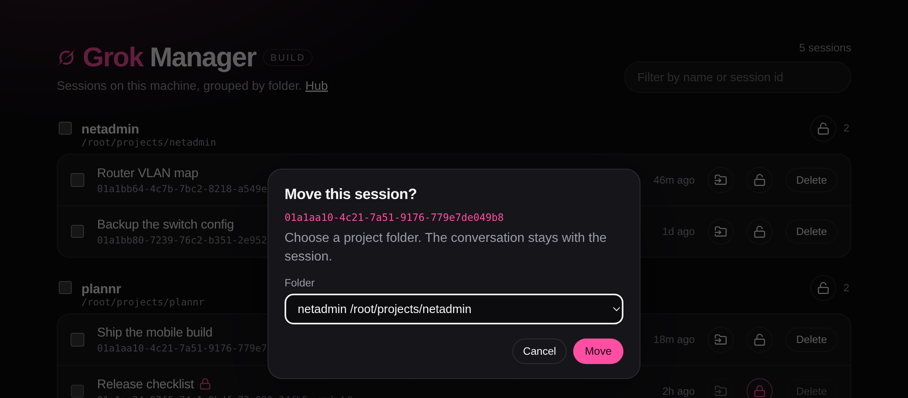

# Grok Build - Sessions Manager

A local page for the Grok sessions on one machine. Sessions are grouped by project folder. You can lock a session or a folder, move a session, and delete one you no longer need.

The page reads `~/.grok/sessions` on the computer where it runs. Nothing is uploaded.



## Highlights

- Click a session id and the clipboard gets `grok --resume <session-id>`, ready to paste into a terminal.
- Click a project path, such as `/root/projects/plannr`, and the clipboard gets `cd <path>`.
- The folder icon moves a session into another folder that is already listed. The transcript is left as it was written.
- The lock icon keeps one session, or every session in a folder, from being moved or deleted until you unlock it.
- A session that is still open is marked **Session Active**. It cannot be moved or deleted while it is open.



## Run

Python 3.11 or newer. No extra packages.

```bash
python3 server.py
```

The app listens on `127.0.0.1:18090`. Open that address in a browser.

`install.sh` adds an nginx site on port 8090 and a systemd service named `grok-manager`. It needs root.

## What stays on your machine

- Session transcripts, titles, and ids
- `locks.json`, the list of sessions and folders you locked
- The search index and dashboard database Grok already keeps

Do not commit `locks.json`. It is listed in `.gitignore`.

Deleting a session removes its directory. That cannot be undone.
